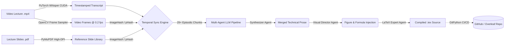
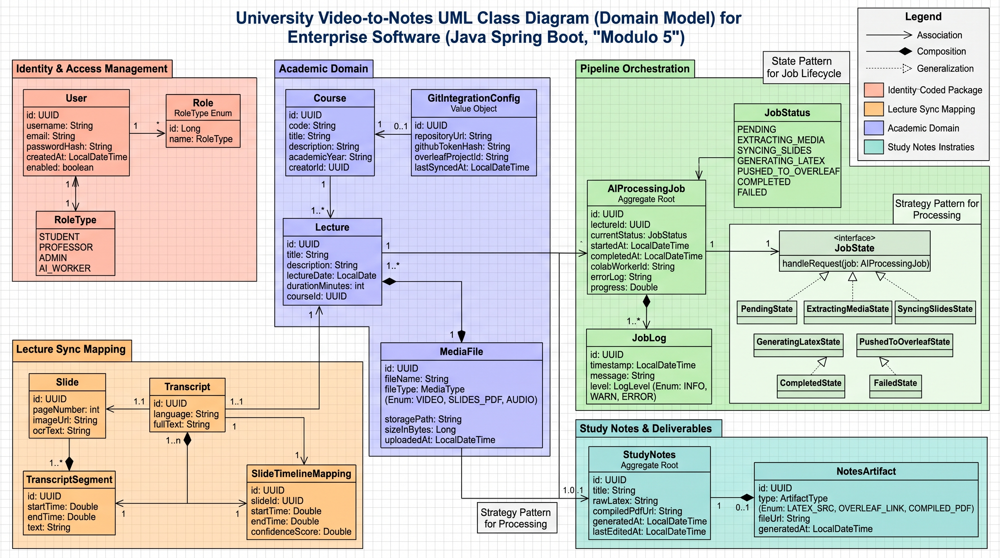

# 🎓 Lecture2LaTeX: Multi-Modal AI & Multi-Agent Pipeline for Automated Academic Notes

**Lecture2LaTeX** is an end-to-end multi-modal processing pipeline designed to convert raw university video lectures (`.mp4`) and presentation slides (`.pdf`) into rigorously formatted, temporally synchronized **LaTeX study notes**.

Traditional LLM summarization tools fail on long academic lectures due to context-window degradation, hallucinations, and inability to correlate spoken explanations with the exact slide displayed on screen—especially when professors jump back and forth between slides. **Lecture2LaTeX** solves this mathematically using **GPU-accelerated speech-to-text**, **perceptual image hashing**, and **episode-based multi-agent orchestration**, backed by a clean **Spring Boot web architecture**.

---

## 🏗️ System Architecture

The pipeline is structured into modular stages designed to run efficiently on cloud GPU instances (e.g., Google Colab NVIDIA T4):

### Module 1: Multi-Modal Data Extraction (`01_Data_Extraction.ipynb`)
* **CUDA-Accelerated ASR:** Extracts audio streams and runs OpenAI `Whisper` / Hugging Face `Transformers` directly in native **PyTorch** on GPU (`.to('cuda')`), generating fine-grained timestamped transcriptions.
* **High-Resolution Slide Rendering:** Uses `PyMuPDF` (`fitz`) to rasterize PDF vector slides into high-DPI images and extract embedded baseline text.

### Module 2: Computer Vision Temporal Synchronization (`02_Video_Slide_Sync.ipynb`)
* **Frame Sampling:** Scans the lecture video stream via `OpenCV`, sampling frames every 5 seconds.
* **Perceptual Hashing (`ImageHash`):** Computes perceptual hashes (`pHash` / `dHash`) for both video frames and PDF slides, matching them via Hamming distance thresholds.
* **Non-Linear Episode Mapping:** Accurately tracks forward/backward slide jumps, off-slide tangents (*excursus*), and low-speech segments, grouping the lecture into coherent, self-contained **Episodic JSON Chunks** (`Slide N <-> [Timestamp Start, Timestamp End]`).

### Module 3: Multi-Agent LLM Synthesis (`03_Multi_Agent_Synthesis.ipynb`)
Instead of feeding a 2-hour transcript into a single prompt, data is processed episode-by-episode through specialized agents powered by **Gemini Flash** & **CrewAI**:
1. **Agent 1 — Technical Synthesizer:** Merges baseline slide bullet points with the professor's spoken explanation, removing conversational filler while strictly preserving mathematical notation and domain terminology.
2. **Agent 2 — Visual Director:** Evaluates visual complexity and injects semantic placeholders (`[INSERT slide_N.jpg]`) where diagrams, architectures, or complex proofs are essential.
3. **Agent 3 — LaTeX Formatter:** Compiles the synthesized episodes into valid, compilable LaTeX (`\section`, `\subsection`, environments, math mode, and frontmatter).

---

## 📊 Current Project Status & Roadmap

| Module | Component | Status | Notes |
| :--- | :--- | :---: | :--- |
| **Module 1** | Audio/PDF Extraction (`Whisper`, `PyMuPDF`) | ✅ **Completed** | Tested on T4 GPU; audio denoising refinement in progress for initial segments. |
| **Module 2** | CV Slide-Video Synchronization (`OpenCV`, `ImageHash`) | ✅ **Completed** | Handles non-linear slide transitions and silent/excursus segments. |
| **Module 3** | Episode Chunking & Agent 1 (Synthesizer) | 🟢 **Active (85%)** | Segmented into 29 episodes; LaTeX output schema validated. |
| **Module 3** | Agent 2 (Visual Director) & Agent 3 (LaTeX Assembler) | 🟡 **In Progress** | Integrating full `CrewAI` `Agent`/`Task`/`Crew` orchestration wrapper. |
| **Module 4** | Automated Overleaf Deployment (`GitPython`) | ⏳ **Planned** | Automated commit/push of `.tex` artifacts to GitHub-synced Overleaf projects. |
| **Module 5** | Web Platform & Software Design (`Spring Boot`, `UML`) | ⏳ **Roadmap** | Applying Software Analysis & Design principles and GoF Design Patterns. |

---

## 🚀 Architectural Extension: Spring Boot Web Platform & Software Design (Module 5)

To integrate the Python AI pipeline into a structured web application, **Module 5** focuses on **Software Analysis and Design (Analisi e Progettazione del Software)** using **Java & Spring Boot**:
* **UML Modeling & Layered Architecture:** Designed starting from formal functional/non-functional requirements and **UML diagrams** (Use Case, Class, Sequence, and Statechart diagrams), enforcing a clean separation between `Controller`, `Service`, `Repository` (Spring Data JPA), and `DTO` layers.
* 
* **Fundamental Design Patterns:** Practical implementation of core software engineering patterns to keep the codebase maintainable and decoupled:
  * **State Pattern:** Manages the lifecycle of lecture processing jobs (`PENDING` $\rightarrow$ `SYNCING_SLIDES` $\rightarrow$ `GENERATING_LATEX` $\rightarrow$ `COMPLETED` / `FAILED`).
  * **Strategy Pattern:** Allows interchangeable synchronization or transcription policies.
  * **Builder & DTO Patterns:** Ensures clean data transfer and REST API contract decoupling between the Spring Boot web platform and the Python Colab worker.
  * **Adapter / Observer Patterns:** Handles external notifications and GitHub/Overleaf integration.

---

## 🛠️ Tech Stack
* **Deep Learning & Audio:** Python, PyTorch (CUDA), OpenAI Whisper, Hugging Face Transformers
* **Computer Vision & Document Processing:** OpenCV (`cv2`), ImageHash, Pillow, PyMuPDF (`fitz`)
* **LLM & Agentic Orchestration:** CrewAI, Google Gemini API, Prompt Engineering, Structured Output Parsing
* **Software Engineering & Web (WIP):** Java, Spring Boot, Spring MVC, Spring Data JPA, SQL, UML Modeling, GoF Design Patterns
* **DevOps & Version Control:** Google Colab (T4 GPU), Git, GitHub, Overleaf, GitPython

---

💡 Note for Recruiters/Reviewers: This is a Showcase Repository. To protect intellectual property, the core logic and proprietary prompts inside the notebooks have been abstracted or stubbed out. The repository contains the full architectural design, domain diagrams, and execution outputs to demonstrate code quality, project structure, and technical proficiency. <!-- **[Lecture2LaTeX-core](https://github.com/SteLib/Lecture2LaTeX-core)** -->

---

## 🔒 License & Copyright

**Copyright © 2026 Stefano Liberati. All Rights Reserved.**

This repository and its contents are published strictly for **academic portfolio evaluation and recruitment purposes**.  
No permission is granted to copy, download, redistribute, modify, or use any part of this codebase or architectural documentation for commercial or derivative works without explicit written consent from the author.

---

## 👤 Author
**Stefano Liberati**  
M.Sc. Student in Cybersecurity Engineering @ *Politecnico di Torino*  
[LinkedIn](https://www.linkedin.com/in/stefano-liberati-3729a0279) | [GitHub](https://github.com/SteLib)
